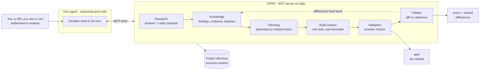

# OPRE — Open Rebuild Engine

**Understand. Rebuild. Reimagine.**

[](https://github.com/Aayushbohora1/opre-mcp/actions/workflows/ci.yml)
[](./LICENSE)
[](https://nodejs.org)
[](#tool-reference)

OPRE is an open-source **MCP server** that lets any compatible AI agent investigate an existing
website or application, build an evidence-backed knowledge base, and then rebuild a working
alternative through an incremental, test-driven loop.

- **Understand** — a real browser and a static analyser record _what was observed_, with sources,
  timestamps, confidence and explicit limitations.
- **Rebuild** — a dependency-ordered backlog, task-scoped context, and a runner that actually
  starts and exercises the generated app.
- **Reimagine** — reconstruct a _capability_, not a screenshot. Observed facts, source-derived
  facts and hypotheses are stored separately, so the agent never guesses silently.

OPRE ships **no AI model of its own**. Your agent reasons and writes code; OPRE provides research,
persistent project state, retrieval, task coordination and validation.

```
your agent (reasoning + code)  ──MCP──▶  OPRE  ──▶  project directory on disk
                                     research · knowledge · planning · validation
```

---

## Try it in 60 seconds

```bash
git clone https://github.com/Aayushbohora1/opre-mcp.git
cd opre-mcp
npm install          # compiles dist/ automatically (prepare script)
npm run demo         # drives the whole loop against https://example.com
npm run rebuild-demo # ...and rebuilds it, then scores the rebuild against the original
```

`npm run demo` opens a real browser, records evidence, drafts a plan, and prints exactly what an
agent would see at each step. `npm run rebuild-demo` goes one step further: it stands in for the
coding agent with a deterministic builder, produces a runnable site, starts it, validates it in a
browser, and then **measures how close it is to the original**:

```
[6/6] fidelity against the reference
  overall 94% close across 1 route(s)

   94%  /  close
        - tokens: missing "size:16px"
```

That number is the point. Without OPRE the builder had a URL and nothing else; with it, the builder
got structured evidence, persisted state, a started server, a real browser check, and an exact list
of what still differs. Both demos use throwaway projects in a temp directory.

Then connect it to your agent:

```json
{
  "mcpServers": {
    "opre": {
      "command": "node",
      "args": ["/absolute/path/to/opre-mcp/dist/index.js"],
      "env": { "OPRE_HOME": "/absolute/path/to/opre-projects" }
    }
  }
}
```

Your client will show **25 `opre.*` tools** and two prompts (`opreweb`, `opreapp`). The agent's
first move should be `opre.get_guide`, which returns the exact next steps for the project.

---

## How it works



Five steps, each writing to disk before the next begins:

1. **Research** — a real browser records what the target does: routes, forms with field names and
   required flags, interactive controls, design tokens, screenshots, console and network errors.
   Every observation becomes a finding with a source, a confidence and an explicit _limitation_.
2. **Planning** — findings become features with verifiable acceptance criteria, and a backlog where
   each task depends only on work that is already done.
3. **Build context** — the agent receives exactly what one task needs, within a character budget;
   anything trimmed is reported so it can be fetched explicitly.
4. **Validation** — OPRE starts the app (no shell, scrubbed environment) and runs the acceptance
   checks in Chromium.
5. **Fidelity** — the running app is diffed against the reference fingerprints, producing a
   per-route score and a named list of what still differs, which becomes the next iteration's input.

Untrusted input is the constant concern: page text, comments and package strings are stored as
evidence, scanned for injected instructions, and never treated as commands.

---

## Requirements

| Requirement                     | Notes                                                                                          |
| ------------------------------- | ---------------------------------------------------------------------------------------------- |
| Node.js ≥ 20.10 (LTS)           | Developed and tested on Node 22/24.                                                            |
| A Chromium build for Playwright | `npx playwright install chromium`. See [browser troubleshooting](#browser-troubleshooting).    |
| An MCP client                   | Any client that speaks stdio MCP (Claude Desktop, Claude Code, Cursor, Windsurf, Continue, …). |

---

## Install

```bash
git clone <your-fork> opre-mcp
cd opre-mcp
npm install
npm run build
node dist/index.js --help
```

During development you can run the server straight from TypeScript:

```bash
npm run dev            # tsx src/index.ts
npm test               # unit + integration (real browser, local fixtures)
npm run verify         # typecheck + lint + tests
```

Projects live under `OPRE_HOME` (default `~/.opre`). Each project is a self-contained directory.

---

## Connect a client

```json
{
  "mcpServers": {
    "opre": {
      "command": "node",
      "args": ["/absolute/path/to/opre-mcp/dist/index.js"],
      "env": {
        "OPRE_HOME": "/absolute/path/to/opre-projects",
        "OPRE_MAX_RESPONSE_CHARS": "24000"
      }
    }
  }
}
```

After connecting, the client should list 24 `opre.*` tools and two prompts (`opreweb`, `opreapp`).
Slash commands are an agent-side convention, not an MCP feature, so OPRE ships ready-made
instructions in [`agents/`](./agents) and [`/.claude/commands`](./.claude/commands) as well as MCP
prompts — use whichever your client supports.

Quick smoke test from a terminal:

```bash
node dist/index.js --print-config
```

---

## The two workflows

### `/opreweb <url>` — rebuild a website

1. `opre.create_project` — validate and record the target URL plus your authorisation.
2. `opre.start_research` — inspect public pages with a real browser (routes, nav, forms,
   interactive elements, viewports, screenshots, console/network errors). Optional web search
   via a configured provider.
3. `opre.get_research_summary` — compact, bounded overview of what was learned.
4. `opre.create_implementation_plan` — `mode: "draft"` proposes features and tasks from the
   researched routes; refine with `opre.upsert_task` / `opre.upsert_feature`, or re-submit with
   `mode: "apply"`.
5. Configure the runner once: `opre.update_project_config` with `runnerCommand` / `runnerArgs` /
   `runnerPort` (e.g. `npm`, `["run", "dev", "--", "--port", "4173"]`).
6. Loop until the plan is satisfied:
   `opre.get_next_task` → `opre.prepare_build_context` → implement in `app/` →
   `opre.record_implementation_result` → `opre.run_validation`.
7. `opre.get_validation_report` and `validation/known-gaps.md` feed the next iteration.

### `/opreapp <package>` — rebuild an application as a web app

Same loop, different first steps:

1. `opre.create_project` with `targetType: "app"` and an explicit authorisation statement.
2. `opre.inspect_app_package` — authorised static analysis of a local `.apk`/`.ipa`/`.zip`
   (archive structure, declared permissions/components, resource names, DEX identifier and
   endpoint literals).
3. `opre.add_finding` for anything you learn from public documentation.
4. Plan, build and validate exactly as in `/opreweb`.

The output is always a **browser-based** application, not an Android package. OPRE recovers
_declared strings only_ — it never claims to have decompiled logic, and it records what it could
not observe.

---

## Tool reference

Every tool has a short title and a description that says _when to use it and what it returns_.
The same copy lives in [`src/tools/catalog.ts`](./src/tools/catalog.ts) — the single owner of the
agent-facing surface.

| Tool                                | Title                      | Use it to                                                                 |
| ----------------------------------- | -------------------------- | ------------------------------------------------------------------------- |
| `opre.create_project`               | Start a project            | Create the isolated workspace for a target.                               |
| `opre.get_guide`                    | What to do next            | Get the stage-aware playbook with example arguments. **Start here.**      |
| `opre.list_projects`                | List projects              | Discover project names/ids.                                               |
| `opre.get_project_status`           | Project status             | See stage, counts, progress, next action.                                 |
| `opre.update_project_config`        | Project settings           | Configure the dev server, app dir, allowed hosts, attempt limits.         |
| `opre.start_research`               | Research the target        | Observe the real site in a browser and store evidence.                    |
| `opre.get_research_summary`         | Research summary           | Read a bounded overview and the explicit unknowns.                        |
| `opre.search_research`              | Search research            | Ranked search over pages and findings.                                    |
| `opre.add_finding`                  | Record a finding           | Store an observed/derived/hypothesis conclusion with limitations.         |
| `opre.search_knowledge`             | Search the knowledge base  | Bounded, paginated search across everything known.                        |
| `opre.get_feature`                  | Get a feature              | Read one feature with criteria, evidence and tasks.                       |
| `opre.upsert_feature`               | Create or update a feature | Write a feature record.                                                   |
| `opre.get_evidence`                 | Get evidence               | Check the observations behind a claim.                                    |
| `opre.get_document_excerpt`         | Read a document            | Excerpt one project document, paginated.                                  |
| `opre.record_note`                  | Record a note              | Append a requirement, decision, uncertainty or workflow.                  |
| `opre.create_implementation_plan`   | Plan the build             | Turn research into features and ordered tasks.                            |
| `opre.list_tasks`                   | List tasks                 | Review the backlog and what is blocked.                                   |
| `opre.get_next_task`                | Next task                  | Take the highest-priority actionable task.                                |
| `opre.upsert_task`                  | Create or update a task    | Write one task and its browser checks.                                    |
| `opre.update_task_status`           | Update task status         | Move a task through its lifecycle.                                        |
| `opre.prepare_build_context`        | Prepare build context      | Get everything one task needs, within budget.                             |
| `opre.record_implementation_result` | Record the result          | Store what was built, what passed, what is missing.                       |
| `opre.run_validation`               | Run validation             | Start the app, run acceptance checks, and score it against the reference. |
| `opre.get_validation_report`        | Validation report          | See run history, failures per task, open gaps.                            |
| `opre.inspect_app_package`          | Inspect an app package     | Authorised static analysis of an `.apk`/`.ipa`/`.zip`.                    |

Unsupported capabilities are never faked: tools return a structured `unsupported_capability`
error with an actionable hint (for example, no web-search provider configured, or no Chromium
available).

---

## Project layout

```
<OPRE_HOME>/<project>/
  opre.json                     manifest: target, authorisation, runner config, allowed hosts
  README.md                     generated index: stage, progress, next task, where things live
  research/
    report.md                   generated report (routes, findings index, errors, blocked requests)
    architecture.md             generated inferences + what cannot be known
    sources.json                every source with trust level and timestamp
    findings.json               findings with embedded evidence and limitations
    pages.json                  per-page inventory: links, forms, interactive elements, assets
  knowledge/
    features.json               features, acceptance criteria, status
    requirements.md             appended requirements
    decisions.md                appended decisions
    uncertainties.md            appended open questions / blocked tasks
    workflows/<id>.md           user-flow notes
  planning/
    plan.md                     generated plan (tasks in dependency order)
    tasks.json                  plan metadata + task records
  validation/
    runs.json                   structured validation runs
    known-gaps.md               failures appended by validation and build results
  artifacts/
    screenshots/                research and validation screenshots
    reports/                    build results, optional research HAR
  app/                          the rebuilt application (written by the agent)
```

The directory name is the readable project slug (`example-com`); a second project for the
same target becomes `example-com-2`. The unique id lives in `opre.json`.

Regenerated markdown (`README.md`, `research/report.md`, `research/architecture.md`,
`planning/plan.md`) is written between `<!-- opre:generated:begin -->` and
`<!-- opre:generated:end -->` markers. Anything you write outside those markers is preserved.

---

## Fidelity: proof, not vibes

This is the part that makes OPRE more than a research dump. During research each page gets a
**fingerprint**: heading tree, landmarks, text blocks, link paths, form signatures, interactive
controls, image alts, and design tokens (colours, font families, sizes, radii) — plus a screenshot.
When you validate the rebuild, OPRE captures the _same_ fingerprint from the running app and diffs
them.

| Section       | Weight | What a mismatch means                 |
| ------------- | ------ | ------------------------------------- |
| headings      | 28%    | wrong information architecture        |
| text          | 22%    | missing or invented copy              |
| links         | 13%    | broken or extra navigation            |
| forms         | 9%     | wrong fields, types or required flags |
| interactive   | 8%     | missing controls                      |
| landmarks     | 8%     | missing header/nav/main/footer        |
| design tokens | 7%     | different look and feel               |
| visual        | 5%     | pixel delta of the screenshots        |

Scoring is F1 per section, so **missing** content and **invented** content are both defects. The
result is a verdict (`match` ≥ 0.95, `close` ≥ 0.8, `partial` ≥ 0.5, otherwise `divergent`), a
per-section breakdown, and a named list of differences. The visual section is a sampled pixel diff
implemented in-tree (no extra dependency) and is always reported together with its tolerance,
because "90% of sampled pixels differ at tolerance 24/255" is a fact, not a vibe.

Fidelity gaps are written to `validation/known-gaps.md` exactly like failed checks, so the next
build iteration starts from the difference list. When there is no reference (a project that never
researched a target), the outcome is reported as `unavailable` — never as a zero.

---

## Is it actually better than just using an agent?

That is a fair question, and it deserves a measurement rather than a claim.
`npm run compare-modes` runs the same deterministic builder three ways against the same target and
scores all three with the same fidelity engine:

| mode                | what the builder gets            | builder input | fidelity        | verified by        | resumable |
| ------------------- | -------------------------------- | ------------- | --------------- | ------------------ | --------- |
| **A** agent only    | a URL, then raw HTML             | 1 kB          | **56% partial** | nothing            | no        |
| **B** agent + tools | raw HTML of each route           | 1 kB          | **56% partial** | nothing            | no        |
| **C** agent + OPRE  | OPRE's research records over MCP | 5 kB          | **94% close**   | browser + fidelity | yes       |

Reproduce with `npm run compare-modes`; the numbers move with the target. On this run OPRE's own
`opre.run_validation` independently reported the same **94%** for the same build.

Read honestly:

- **OPRE's advantage is not less context — it is better-shaped context.** Mode C read _more_ bytes
  and scored ~40 points higher, because the bytes were structured: landmarks, form field names and
  required flags, interactive controls, image alts, design tokens, provenance. Raw HTML yields text
  and hrefs, and nothing else.
- **Without OPRE nothing checks the result.** A and B have no way to know whether what they built
  matches; they rely entirely on the agent's own confidence. Mode C got a browser check and a
  per-route difference list written into `known-gaps.md`.
- **Without OPRE the work cannot be resumed.** Tasks, findings and decisions live in the project
  directory, so a new session continues; a conversation-only agent re-derives everything.
- **This is a lower bound, not a ceiling.** The builder here is deterministic on purpose, so it
  isolates the information advantage. A real LLM agent adds judgement to _every_ row and would beat
  all three — but it would still be guessing without the evidence, the persisted state, and the
  number.
- **Where the gap is small:** one trivial page. **Where it is large:** many routes, long sessions,
  and any requirement to _prove_ what was built. OPRE also cannot help with authenticated areas or
  with the coding judgement itself.

---

## Configuration (environment variables)

All configuration is environment-based, validated at startup, and printed by
`node dist/index.js --print-config`.

| Variable                       | Default                           | Purpose                                                         |
| ------------------------------ | --------------------------------- | --------------------------------------------------------------- |
| `OPRE_HOME`                    | `~/.opre`                         | Directory that contains all projects. Must be absolute.         |
| `OPRE_MAX_RESPONSE_CHARS`      | `24000`                           | Hard ceiling for one tool response, in characters.              |
| `OPRE_MAX_ITEMS`               | `25`                              | Default page size for retrieval tools.                          |
| `OPRE_RESEARCH_MAX_PAGES`      | `25`                              | Page cap per research run.                                      |
| `OPRE_RESEARCH_MAX_DEPTH`      | `2`                               | Link depth per research run.                                    |
| `OPRE_RESEARCH_CONCURRENCY`    | `3`                               | Pages inspected at once. Raise for speed, lower for politeness. |
| `OPRE_RESEARCH_TIMEOUT_MS`     | `30000`                           | Per-navigation timeout.                                         |
| `OPRE_RESEARCH_MAX_LINKS`      | `100`                             | Links captured per page.                                        |
| `OPRE_RESEARCH_VIEWPORTS`      | `desktop:1440x900;mobile:390x844` | Viewport list for responsive capture.                           |
| `OPRE_RESEARCH_SCREENSHOTS`    | `true`                            | Capture a screenshot per visited page.                          |
| `OPRE_RESEARCH_HAR`            | `false`                           | Record a HAR file into `artifacts/reports/`.                    |
| `OPRE_USER_AGENT`              | OPRE bot UA                       | User agent used by the research/validation browser.             |
| `OPRE_WEB_SEARCH_PROVIDER`     | `none`                            | `none` or `searxng`. No provider ⇒ no search results, ever.     |
| `OPRE_SEARXNG_URL`             | –                                 | Base URL of a SearXNG instance with JSON output enabled.        |
| `OPRE_SEARCH_MAX_RESULTS`      | `8`                               | Results kept per search query.                                  |
| `OPRE_SEARCH_TIMEOUT_MS`       | `20000`                           | Search timeout.                                                 |
| `OPRE_BROWSER_EXECUTABLE`      | –                                 | Path to an existing Chromium/Chrome binary.                     |
| `OPRE_BROWSER_HEADLESS`        | `true`                            | Run the browser headless.                                       |
| `OPRE_ALLOW_PRIVATE_NETWORK`   | `false`                           | Allow targets that resolve to private/loopback addresses.       |
| `OPRE_MAX_DOWNLOAD_BYTES`      | `25000000`                        | Size ceiling for package inspection inputs.                     |
| `OPRE_RUNNER_ENABLED`          | `true`                            | Master switch for starting the generated app.                   |
| `OPRE_DEFAULT_PORT`            | `4173`                            | Port used when the project does not set one.                    |
| `OPRE_SERVER_START_TIMEOUT_MS` | `60000`                           | How long to wait for the dev server.                            |
| `OPRE_VALIDATION_TIMEOUT_MS`   | `30000`                           | Per-check browser timeout.                                      |
| `OPRE_MAX_VALIDATION_ATTEMPTS` | `3`                               | Retries per task before the loop stops.                         |
| `OPRE_LOG_LEVEL`               | `error`                           | `silent`, `error`, `warn`, `info` (stderr only).                |

See [`.env.example`](./.env.example) for a copy-paste starting point.

### Browser troubleshooting

If `npx playwright install chromium` cannot download (restricted network), OPRE falls back in this
order: `OPRE_BROWSER_EXECUTABLE` → the full headless Chromium build → the default Playwright
Chromium. If none can launch, browser tools return an `unsupported_capability` error explaining
what to install — non-browser features keep working.

---

## Context safety

OPRE is designed around the assumption that the agent's context is expensive and finite.

- Retrieval tools return **ranked, bounded, paginated** results with ids — never the whole corpus.
- Document tools return **paths, sizes and excerpts**, not full file contents.
- Every response is measured against `OPRE_MAX_RESPONSE_CHARS`; when a payload is too large, items
  are dropped deterministically and the response says how many.
- `opre.prepare_build_context` assembles **only what one task needs** and reports which sections
  were trimmed, so the agent can request them explicitly.
- State (tasks, decisions, progress) lives on disk, so it never has to be re-fed every session.
- OPRE makes **no claim** about the host agent's context window, history or compaction. Its limits
  are character/byte ceilings it actually enforces, described as such.

---

## Security model

Research targets, pages, READMEs and packages are treated as **untrusted data**.

| Risk                                        | Mitigation                                                                                                                                                                |
| ------------------------------------------- | ------------------------------------------------------------------------------------------------------------------------------------------------------------------------- |
| Prompt injection in page content            | Content is stored as evidence with `trust: "untrusted"`, wrapped with an explicit warning, and scanned for injection patterns; matches become findings, not instructions. |
| Path traversal / writes outside the project | Every project-relative path goes through `resolveInside` and a symlink-escape check.                                                                                      |
| Unsafe URL schemes & SSRF                   | Only `http(s)`, no credentials in URLs, private/loopback literals blocked, DNS results checked, per-request filtering during crawling, redirects re-validated.            |
| Local file / secret exposure                | Credential-shaped strings are redacted before storage or output; child processes get a scrubbed environment.                                                              |
| Arbitrary command execution                 | No shell, ever. Denylisted executables, no metacharacters, fixed working directory inside the project, and `OPRE_RUNNER_ENABLED` kill switch.                             |
| Untrusted build scripts                     | OPRE never runs `npm install` or project scripts itself; you configure the dev command explicitly.                                                                        |
| Cross-project contamination                 | Every operation is scoped to one project directory; ids are resolved only under `OPRE_HOME`.                                                                              |
| Data loss                                   | Generated sections are marker-delimited; append-only notes; atomic writes (temp + rename).                                                                                |

OPRE will not bypass authentication, paywalls, access controls or anti-bot protections, and it has
no stealth, credential-theft or security-bypass features. Only analyse software you own or are
authorised to inspect. See [SECURITY.md](./SECURITY.md) for reporting issues.

---

## Development

```bash
npm install
npm run typecheck     # tsc --noEmit, strict
npm run lint          # eslint (type-checked rules)
npm run format        # prettier
npm test              # unit + integration (85 tests, includes real-browser runs)
npm run test:e2e      # builds dist/, drives the built server AND the source server over stdio
npm run demo          # one-command walkthrough against a real site
npm run bench         # measured performance table
npm run verify        # everything the CI runs, minus the build
```

### Performance

`npm run bench` measures what a user actually feels. Current numbers on a modest laptop
(4-page research, 200 synthetic findings):

| Operation                              | Before | After   |
| -------------------------------------- | ------ | ------- |
| cold start → first tool list           | 604 ms | ~290 ms |
| research, 4 pages, concurrency 3       | 3.84 s | 2.65 s  |
| `opre.search_knowledge` (200 findings) | 6 ms   | 6 ms    |
| MCP tool call round-trip               | 1 ms   | 1 ms    |

What made the difference: Playwright is imported lazily (most tool calls never need a browser),
and pages are inspected concurrently while results stay in deterministic frontier order.

Layout of the source:

```
src/
  config.ts            environment parsing/validation
  server.ts            MCP server assembly (transport-agnostic)
  index.ts             stdio entry point + CLI flags
  core/                errors, ids, atomic JSON store, markdown sections, budget helpers
  security/            path containment, URL/SSRF policy, untrusted-content handling
  project/             manifest, layout, create/resolve/list
  research/            crawler, search adapter, reports, app inspection (zip/axml/dex)
  knowledge/           features, documents, bounded search
  planning/            plan drafting/applying, task persistence, next-task selection
  build/               task-scoped build context, implementation results
  validation/          dev-server runner, browser checks, runs and feedback loop
  tools/               MCP tool registrations grouped by domain
    catalog.ts         the agent-facing surface: every tool title + description
    guide-tools.ts     opre.get_guide — stage-aware next steps
scripts/               demo.mjs (walkthrough), bench.mjs (performance), smoke.mjs
```

Milestone status and design decisions are tracked in [`docs/DEVELOPMENT_LOG.md`](./docs/DEVELOPMENT_LOG.md).

---

## Contributing, security, licence

- [CONTRIBUTING.md](./CONTRIBUTING.md) — setup, ground rules, how to add a tool.
- [SECURITY.md](./SECURITY.md) — threat model, controls, private reporting.
- [`agents/README.md`](./agents/README.md) — the two workflows as agent instructions, for clients
  without slash-command support.
- MIT licensed. Respect the licences of dependencies and of anything you analyse.

---

## What works today

Verified by the test suite (unit + integration + stdio end-to-end):

- An MCP client can connect over stdio and call all 24 tools; two prompts are exposed.
- Projects are created, isolated, listed and resumed across server restarts.
- Website research runs a real Chromium against an authorised target and persists pages,
  screenshots, sources, findings and evidence; blocked requests and injection signals are recorded.
- Planning drafts a dependency-ordered plan from research; the next task is selected by priority
  and dependency readiness.
- Build context is task-scoped and budget-bounded; implementation results update task status,
  feature status and known gaps.
- The runner starts a real dev server (no shell, scrubbed env) and Playwright checks run against
  it; failures, screenshots, console errors and failed requests are stored and re-readable.
- Application packages are inspected statically with clear statements of what that cannot reveal.
- Security controls (path traversal, SSRF, shell metacharacters, denied executables, symlink
  escapes, secret redaction) are covered by tests.

## Known limitations

Stated plainly, and also returned by the tools themselves:

- **No AI model.** OPRE orchestrates; the connected agent does the reasoning and coding.
- **No web search by default.** Configure a SearXNG instance; otherwise OPRE says so instead of
  inventing results.
- **Authenticated areas are not visited.** OPRE does not bypass logins, paywalls or bot protection.
- **Crawl coverage is bounded** by page/depth/time limits; deeper areas stay unobserved.
- **Application inspection reads declared strings only** — no decompilation to source, no runtime
  behaviour, no server-side logic.
- **Visual equivalence is not proof of functional equivalence.** Validation checks are declarative
  assertions you define; OPRE does not claim completeness from a passing subset.
- **Transport** is stdio only in v1. The server is transport-agnostic, but no HTTP transport is
  shipped.
- **Not yet implemented:** multi-agent coordination, authenticated research sessions, diffing
  against a live target over time, and automatic dependency-manager support for generated apps.

---

## License

MIT — see [LICENSE](./LICENSE). Respect the licenses of third-party dependencies and of any project
you analyse; do not copy proprietary source into generated projects without authorisation.
